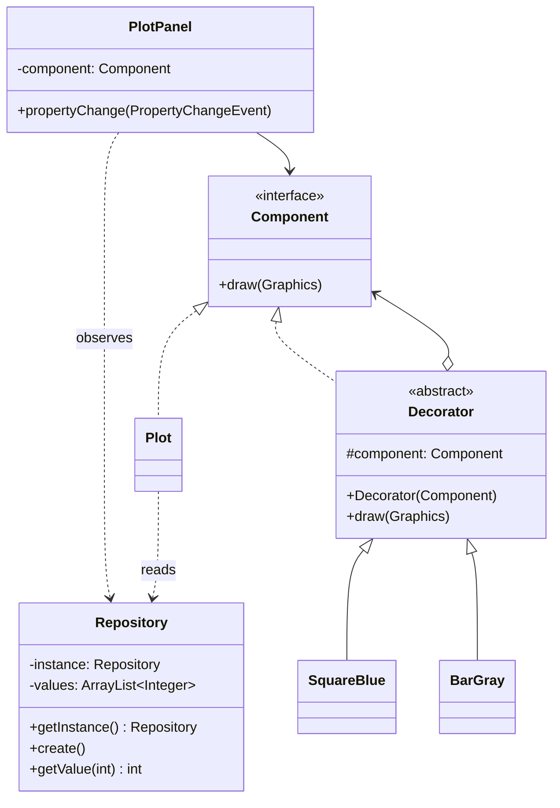
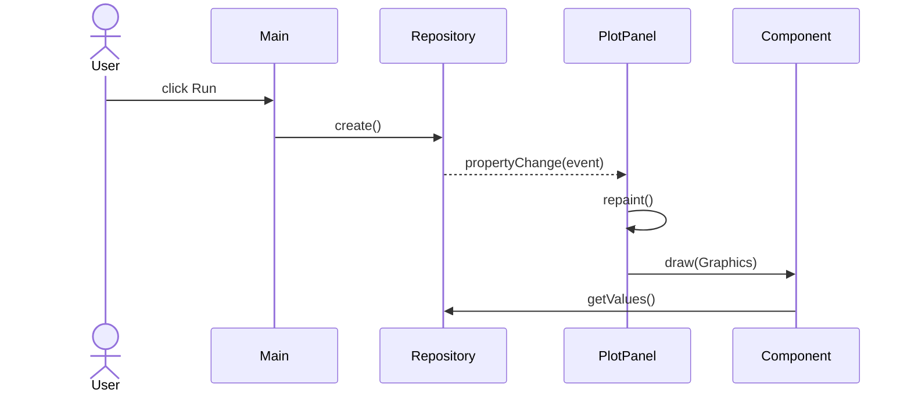

# Architecture

## Class relationships

## When the user clicks Run

The three panels register independently with the same repository. Decorators receive their wrapped component through constructors. The drawing chains differ: `BarGray → SquareBlue → Plot`, `SquareBlue → Plot`, and `Plot`.
